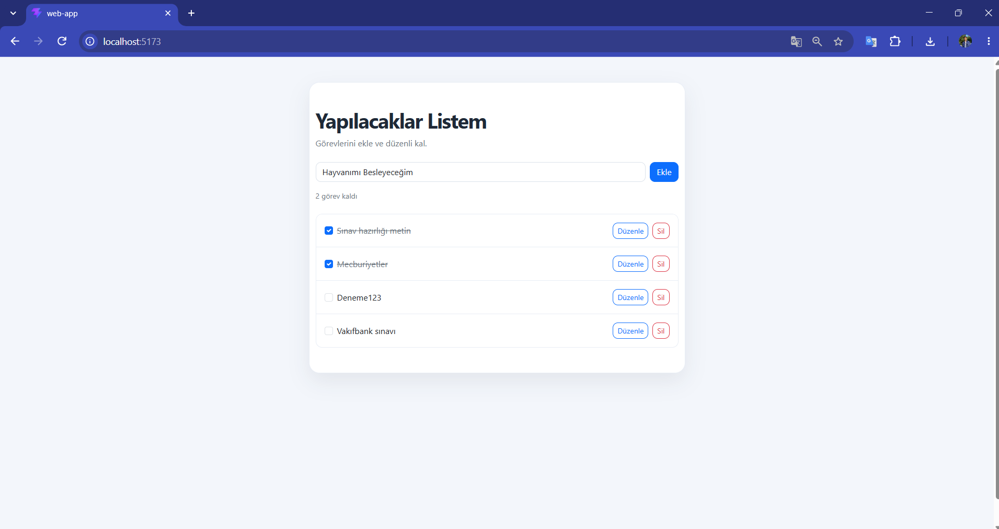
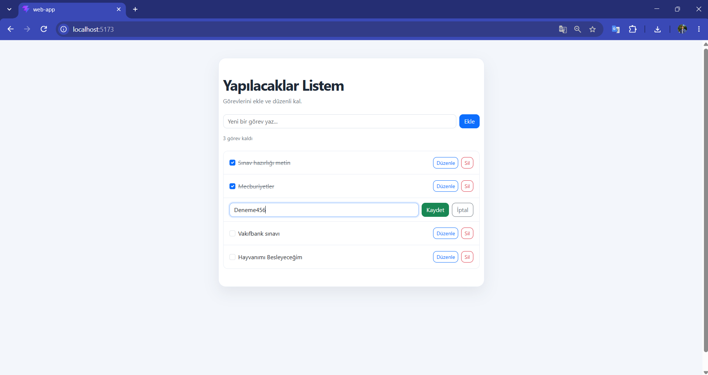
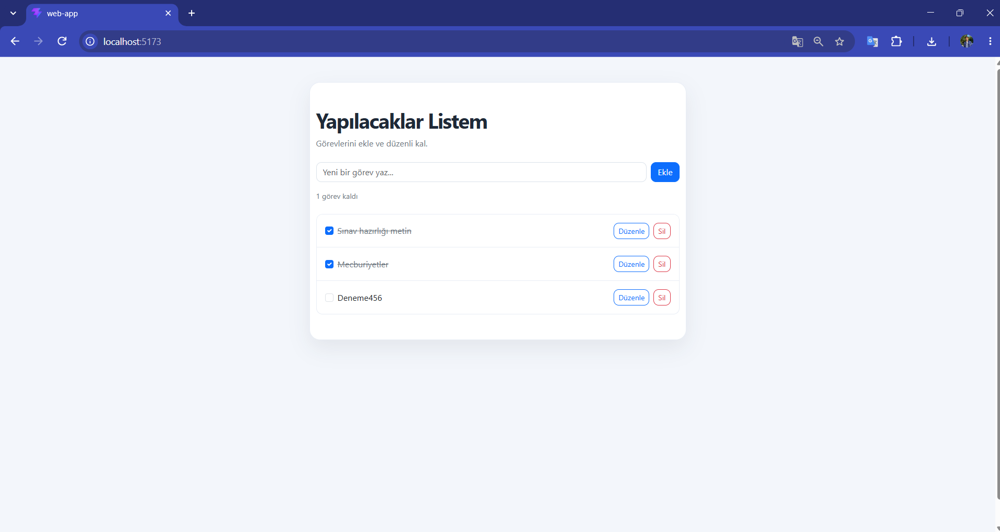

# Yapılacaklar Listem

React ile geliştirilmiş basit bir yapılacaklar uygulaması. Görevler tarayıcının `localStorage` alanında saklanır; sayfa yenilendiğinde kaybolmaz.

## Özellikler

- Görev ekleme ve listeleme
- Görevleri düzenleme ve silme
- Görevleri tamamlandı olarak işaretleme
- Kalan görev sayısını görüntüleme
- Görevleri `localStorage` ile saklama

## Kullanılan Teknolojiler

- React
- JavaScript
- Vite
- Bootstrap 5
- CSS

## Ekran Görüntüleri







## Projeyi Çalıştırma

Bilgisayarında Node.js kurulu olmalıdır.

1. Proje klasöründe terminal aç.
2. Paketleri kur:

   ```bash
   npm install
   ```

3. Geliştirme sunucusunu başlat:

   ```bash
   npm run dev
   ```

4. Terminalde gösterilen yerel adresi tarayıcıda aç.

## Üretim Sürümünü Oluşturma

```bash
npm run build
```

Oluşturulan dağıtım dosyaları `dist` klasörüne kaydedilir.

## Bağlantılar

- GitHub deposu: https://github.com/firnox61/web-app
- Canlı uygulama: Netlify’da yayınlandıktan sonra eklenecek